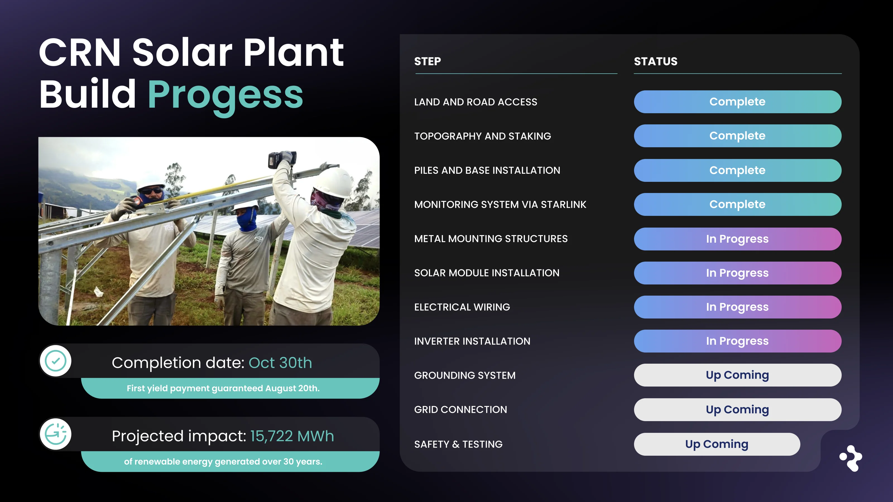
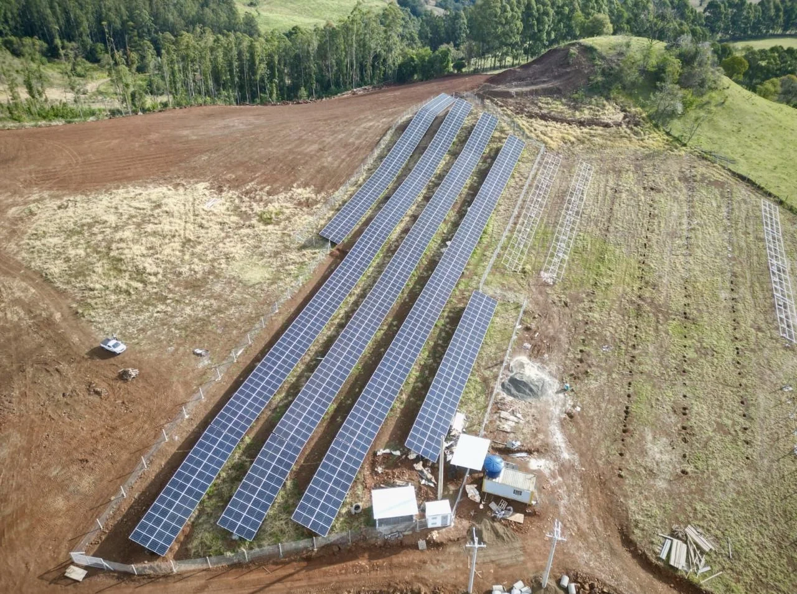

## CRN Solar Plant: Construction Update

In March, capital was deployed to fund the CRN Solar Plant, an operating-scale renewable energy project in **Santa Catarina, Brazil**. Construction is progressing, with the project now moving through the latter stages of civil works and equipment installation.

### Construction Progress & Timeline

Site development encountered several execution-related constraints:

-   Initial site access limitations required additional land preparation to accommodate heavy equipment
-   Persistent rainfall delayed concreting activities
-   Subsurface rock conditions increased pile drilling time

These factors have extended the construction schedule by approximately **eight weeks**, with revised mechanical completion now targeted for **October 30**.

Despite these delays, mounting structures are in place and panel installation is underway. Upcoming milestones include grid interconnection, grounding systems, and commissioning tests.

#### Distributions During Construction

Contractual distribution mechanics remain unchanged. Scheduled distribution windows during the construction phase continue in accordance with the project terms, independent of grid activation timing. These payments are defined by contract structure rather than construction milestones.

#### Operating Reality

Deploying capital into physical infrastructure involves exposure to real-world constraints — weather, terrain, logistics, and permitting — none of which can be abstracted away. These factors introduce variability, but they also reflect the reality of building long-life operating assets.

Progress on site reflects tangible advancement toward commissioning and long-term operation. Updates will continue to be reported as construction milestones are reached and operating data becomes available.

Thank you to participants for their role in supporting the development of this project. Further updates will be provided as construction and commissioning milestones are reached.

Information on future projects is shared via the ReFi Hub mailing list: [https://www.refihub.io/#sign-up](https://www.refihub.io/#sign-up)
