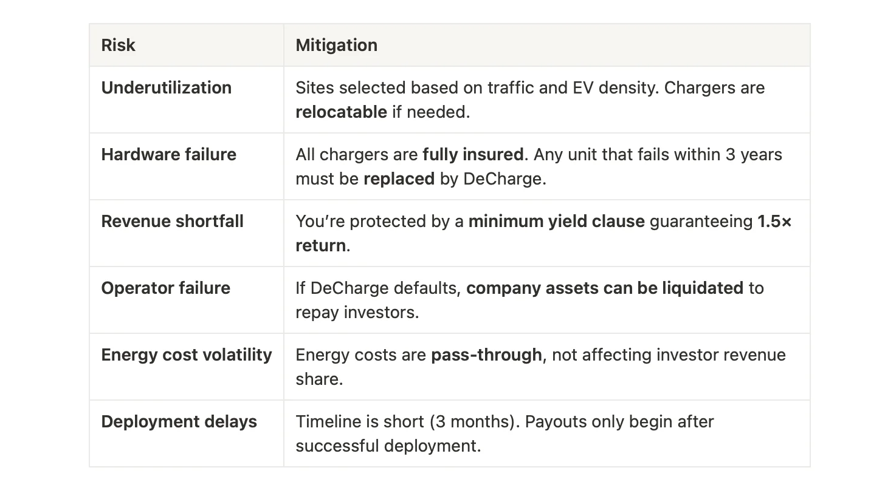
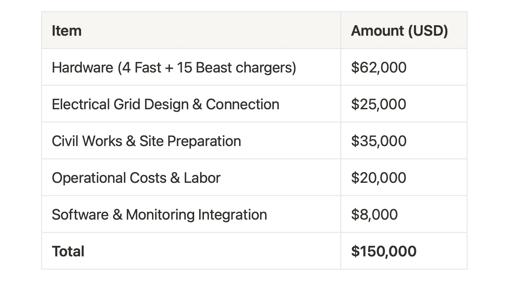

## Investor FAQ – DeCharge: EV Charging Infrastructure on Solana

##### 1\. What exactly am I investing in?

You’re funding the deployment of **19 EV chargers** (4 fast DC, 15 standard AC) across three high-traffic highway corridor sites near **Bangalore, India**.

This is a **yield-generating, real-world infrastructure asset**. You invest via ReFi Hub and earn a share of revenue from EV charging fees.

[**Maps Link**](https://www.google.com/maps/dir/Coastal+King,+SM+Road,+Kalahasti+Nagar,+Prashanth+Nagar,+T.+Dasarahalli,+Bengaluru,+Karnataka,+India/KKB+CAR+CARE,+573,+Hesarghatta+Rd,+near+Govt+School,+Chikkabanavara,+Bengaluru,+Karnataka+560090,+India/4B+Sports+Arena,+Sir+M+Vishweshwaraiah+Layout+6th+Block,+Ullal+Uppanagar,+Ullal,+Bengaluru,+Karnataka,+India/MP+SPORTS+CLUB,+MP+Sports+Club+Road,+Jnananjyothinagar,+Srirama+Layout,+Jnana+Ganga+Nagar,+Bengaluru,+Karnataka,+India/@13.0331909,77.4999615,12.5z/data=!4m26!4m25!1m5!1m1!1s0x3bae3d28bc03543b:0x4cc251762526070!2m2!1d77.520747!2d13.043797!1m5!1m1!1s0x3bae231224998989:0x1894e403595185!2m2!1d77.4983011!2d13.0852079!1m5!1m1!1s0x3bae3f6e33cdb3c1:0xb15bae2d05198241!2m2!1d77.4766507!2d12.9534497!1m5!1m1!1s0x3bae3e9c06dbfd9f:0x35b15daf110f7b7!2m2!1d77.4992052!2d12.9570313!3e0?entry=tts&g_ep=EgoyMDI1MDgxOS4wKgBIAVAD&skid=d3d8ab67-3611-4d40-81d9-38ce98f69e5f)

##### 2\. Why does this opportunity matter now?

India's EV market is growing fast, but long-distance charging infrastructure is lagging. This corridor sees up to **3,600 EVs/day**, creating real demand.

This project helps close that infrastructure gap while giving you **exposure to high-demand, on-chain infrastructure**.

##### 3\. What are FITs and ownership agreements?

-   An **ownership agreement** gives you **partial ownership of a revenue-generating asset**, such as the EV chargers in this project.
-   **FITs (Fractional Investment Tokens)** are digital tokens you receive after investing. They represent your ownership and enable you to claim **periodic yield payouts** on-chain.

##### 4\. How do I earn returns?

Returns come from net profits generated by charging sessions.

After energy costs and capped operations costs are deducted:

-   **60% of net profits go to investors**
-   **30% to DeCharge**
-   **10% to ReFi Hub**

Payouts begin **January 2026** and are issued monthly.

##### 5\. How are distributions determined?

Distributions are determined by the project’s realized operating cashflows and are paid in accordance with the contractual revenue-share structure, not fixed return targets.

##### 6\. How long does this investment last?

This ownership agreement runs for a **minimum of 3 years**. If the chargers remain active beyond that, yield distribution can continue up to 5 years.

DeCharge is incentivized to keep chargers operational past year 3.

##### 7\. Can I sell my FITs?

Currently, FITs are non-transferable. Any future changes to transferability or secondary liquidity would be subject to regulatory considerations and platform readiness, and will be communicated if and when applicable.

##### 8\. What are the main risks, and how are they mitigated?

##### 9\. Who is behind this project?

**DeCharge:** [https://sales.decharge.network](https://sales.decharge.network/) is a Singapore-based EV infrastructure company with:

-   **300+ chargers deployed**
-   Over **1 million minutes of charging time**
-   **52% repeat customer rate**

Their team includes experts with experience at **Tesla, Lucid, and Web3 infrastructure** platforms.

##### 10\. Where are the chargers being installed?

Three high-demand sites near **Bangalore**, selected for:

-   Proximity to **national highways**
-   High vehicle flow (60k–100k/day)
-   Strategic placement for both fast and destination charging

Locations include **highway exits** and **destination hubs** (e.g. hostels, restaurants, fleet stops).

##### 11\. Why mix fast (60kW) and mid-speed (7kW) chargers?

Each serves a unique use case:

-   **Fast chargers** meet demand from short-stop highway users.
-   **7kW Beasts** are ideal for **long-dwell usage** like fleet vehicles, overnight stops, or logistics operators.

This dual approach increases uptime and improves return per dollar deployed.

##### 12\. How will the $150,000 be used?

See breakdown on [**listing page**](https://app.refihub.io/investments/7).

##### 13\. How does the investment process work?

1.  **You invest** and receive FITs representing your share of the project.
2.  **DeCharge deploys** the chargers using the capital raised.
3.  **Revenue is generated** through EV charging usage.
4.  **Net profits are split**, and you **claim your yield** through the ReFi Hub platform.

##### 14\. How is performance tracked and reported?

All chargers are connected to **smart-metered hardware** and integrated with DeCharge’s backend. This enables: transparent, real-time energy usage and revenue data.

##### 10. Where can I learn more and invest?

In [https://app.refihub.io/investments/7](https://app.refihub.io/investments/6)
