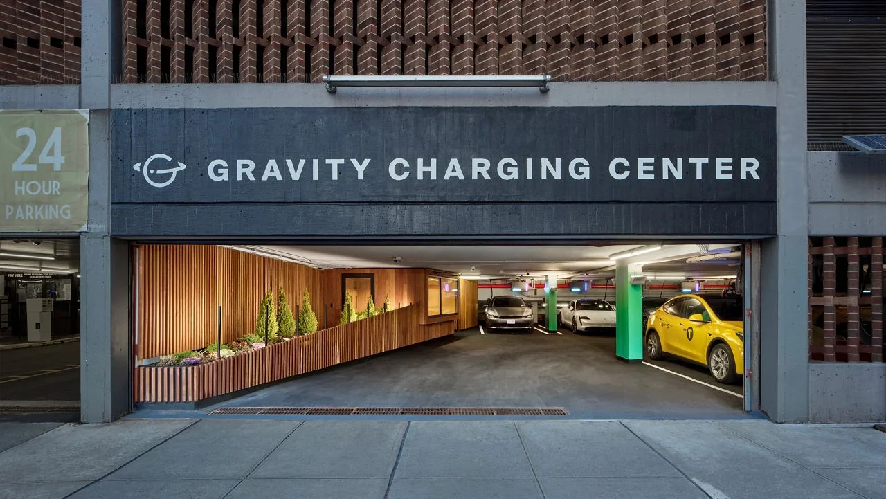
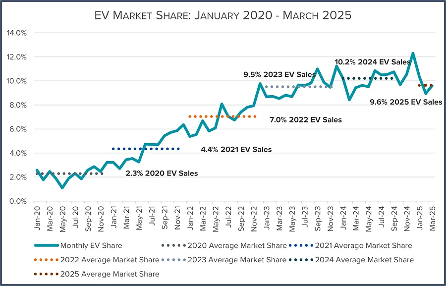
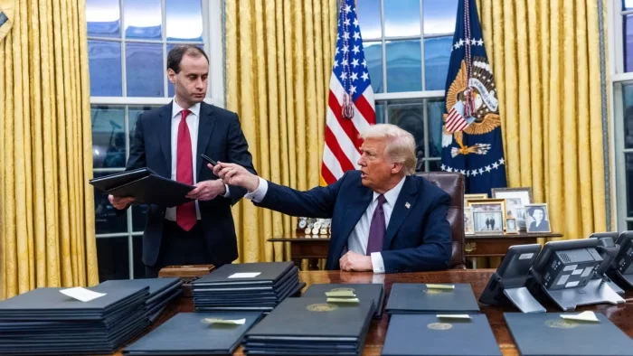
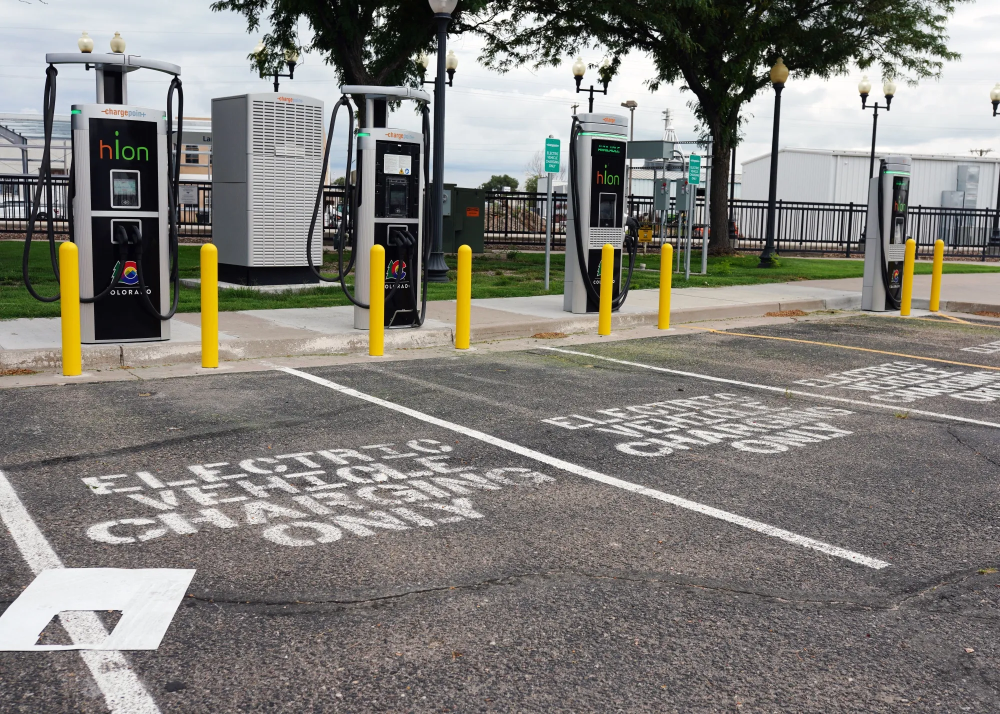

## EV Charging in the U.S: Risk & Opportunity in a Shifting Market

Electric vehicle charging infrastructure sits at the intersection of transport, power markets, and public policy. While federal signals are shifting, the underlying question remains unchanged: where does utilization concentrate, and where is infrastructure still undersupplied?

This note looks at the U.S. charging market through that lens.

### Market Context

The U.S. is the world’s third-largest EV market, behind China and the EU. In 2024, **1.3 million battery electric vehicles**were sold, with long-term growth still projected at a **25.4% compound annual rate** based on global and regional adoption trends¹.

Adoption continues despite volatility:

-   **740,000 plug-in vehicles** sold in H1 2025²
-   EVs maintained roughly **9% monthly share** of new vehicle sales²
-   More than **4.1 million EVs** were on U.S. roads by the end of 2024³
-   The installed base is expected to reach **~5 million vehicles by end-2025**, assuming current penetration trends continue³

For charging infrastructure, this installed base matters more than short-term sales cycles. Vehicles already on the road require regular charging, particularly in retail, workplace, and corridor locations where dwell times are predictable and monetizable.

#### Near-Term Friction

Short-term headwinds are visible:

-   EV sales declined **6.2% in June**, marking the third consecutive monthly decline²
-   Consumer openness to EVs fell to **51% in 2025**, down from 59% in 2023⁴
-   Federal clean-energy and EV support policies are being rolled back under the current administration⁵

These dynamics primarily affect **new vehicle demand**, not the charging behavior of EVs already in circulation.

### Policy Shifts – What to Watch

Recent federal changes introduce both uncertainty and clarity:

-   Federal EV tax credits scheduled to end **September 2025**⁶
-   Regulatory credit regimes (including CAFE and similar mechanisms) facing phase-outs by **2027**, affecting automaker economics⁷
-   Home energy and charger incentives expected to expire **mid-2026**⁸

At the same time, public charging funding remains active. In **June 2025**, a federal judge ordered the reinstatement of **$5 billion in NEVI funding**, unlocking stalled public charger projects across **14 states**, including California, New York, and Washington⁹.

### Infrastructure Reality: Supply vs. Demand

The U.S. currently has approximately **84,000 public charging stations**, resulting in an **EV-to-charger ratio of ~18:1**¹⁰.

For comparison:

-   China: **~10:1**¹
-   EU: **~13:1**¹

In several urban markets, **fast-charger utilization exceeds 25%**, indicating existing pressure on available infrastructure¹¹. Demand is already straining supply, independent of whether the next wave of EV adoption accelerates or pauses.

Charging utilization is tied to vehicles already deployed—not quarterly sales figures.

### Where to Watch

While federal policy is in flux, **state-level mandates continue to anchor infrastructure development**.

-   **California** remains the most mature EV market, supported by long-standing ZEV mandates, dense urban demand, and sustained public funding¹².
-   **New York** continues to see growth in public charging demand, particularly in dense urban regions where home charging is limited¹.
-   **Maryland** stands out as an emerging focus:
    -   Positioned along a high-traffic corridor linking D.C., Baltimore, and Philadelphia
    -   State-level ZEV mandates remain intact¹³
    -   Charger availability remains constrained, with an **EV-to-charger ratio of ~24:1**, well above the national average¹¹

Maryland combines regulatory continuity with structural undersupply—conditions that warrant closer monitoring.

### Final View

The U.S. EV market may be experiencing a short-term reset, but the **infrastructure layer operates on longer cycles**. Utilization is driven by the installed vehicle base, and that base continues to expand.

Markets such as California and New York demonstrate mature demand, while states like Maryland highlight where structural gaps remain. Policy risk is real, but so is physical demand. When adoption rebounds, the chargers already deployed—and well-sited—are positioned to benefit first.

This is a market that rewards selectivity, location discipline, and patience.

#### Sources & References

1.  International Energy Agency — *Global EV Outlook 2024*  
    [https://www.iea.org/reports/global-ev-outlook-2024](https://www.iea.org/reports/global-ev-outlook-2024)
2.  Argonne National Laboratory — *Light-Duty Electric Drive Vehicle Monthly Sales Updates*  
    [https://www.anl.gov/esia/light-duty-electric-drive-vehicles-monthly-sales-updates](https://www.anl.gov/esia/light-duty-electric-drive-vehicles-monthly-sales-updates)
3.  Edmunds — *How Many Electric Cars Are in the U.S.?*  
    [https://www.edmunds.com/electric-car/articles/how-many-electric-cars-in-us.html](https://www.edmunds.com/electric-car/articles/how-many-electric-cars-in-us.html)
4.  MishTalk — *Few Want EVs Even With Deep Discounts and Incentives*  
    [https://mishtalk.com/economics/few-want-evs-even-with-deep-discounts-and-incentives/](https://mishtalk.com/economics/few-want-evs-even-with-deep-discounts-and-incentives/)
5.  DeCharge — *U.S. Market Weigh-Up (Internal Research)*  
    [https://www.notion.so/DeCharge-US-market-weigh-up-article-238375687db780d8a942ccab839582f2?pvs=21](https://www.notion.so/DeCharge-US-market-weigh-up-article-238375687db780d8a942ccab839582f2?pvs=21)
6.  Plug In America — *Federal EV Tax Credits (2024)*  
    [https://pluginamerica.org/learn/federal-ev-tax-credits/2024-info/](https://pluginamerica.org/learn/federal-ev-tax-credits/2024-info/)
7.  Reuters — *Regulatory Credits and EV Automaker Margins*  
    [https://www.reuters.com/business/autos-transportation/teslas-easy-money-regulatory-credits-set-dry-up-amid-weakening-sales-2025-07-22/](https://www.reuters.com/business/autos-transportation/teslas-easy-money-regulatory-credits-set-dry-up-amid-weakening-sales-2025-07-22/)
8.  Cool Davis — *Federal Home Energy Incentives Expiring*  
    [https://www.cooldavis.org/2025/07/23/dont-miss-out-federal-home-energy-incentives-expire-soon/](https://www.cooldavis.org/2025/07/23/dont-miss-out-federal-home-energy-incentives-expire-soon/)
9.  Politico E&E News — *Judge Orders Reinstatement of EV Charging Funds*  
    [https://subscriber.politicopro.com/article/eenews/2025/06/25/judge-orders-trump-admin-to-reinstate-ev-charging-funds-00423249](https://subscriber.politicopro.com/article/eenews/2025/06/25/judge-orders-trump-admin-to-reinstate-ev-charging-funds-00423249)
10.  U.S. Department of Energy — *Alternative Fuels Data Center (Charging Locations)*  
     [https://afdc.energy.gov/fuels/electricity-locations#/find/nearest?fuel=ELEC](https://afdc.energy.gov/fuels/electricity-locations#/find/nearest?fuel=ELEC)
11.  Paren — *State of the Industry: U.S. EV Fast Charging Q1 2025*  
     [https://www.paren.app/blog/state-of-the-industry-report-us-ev-fast-charging-q1-2025](https://www.paren.app/blog/state-of-the-industry-report-us-ev-fast-charging-q1-2025)
12.  State of California — *EV Chargers vs. Gasoline Nozzles*  
     [https://www.gov.ca.gov/2025/03/20/california-now-has-48-more-ev-chargers-than-gasoline-nozzles-in-the-state/](https://www.gov.ca.gov/2025/03/20/california-now-has-48-more-ev-chargers-than-gasoline-nozzles-in-the-state/)
13.  Maryland Department of the Environment — *Zero Emission Vehicle Program*  
     [https://mde.maryland.gov/programs/air/mobilesources/pages/zev.aspx](https://mde.maryland.gov/programs/air/mobilesources/pages/zev.aspx)
