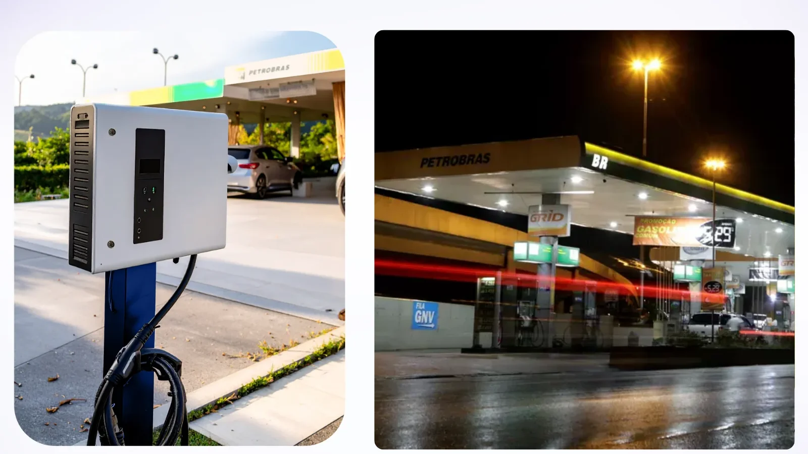
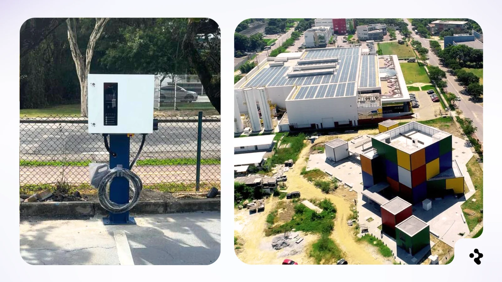
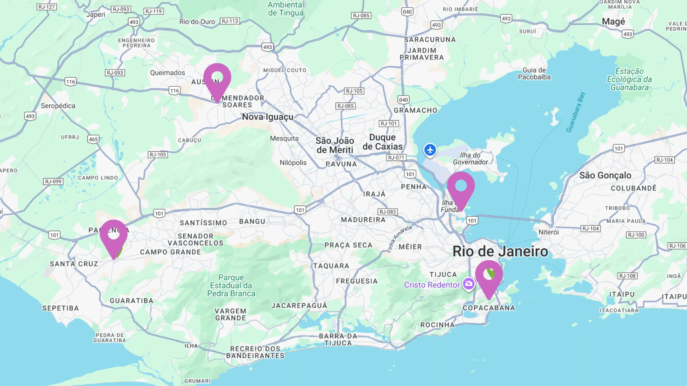

### Network Overview

The [VOX E-Power](https://www.voxepower.com/) network remains in the early utilization phase of [ReFi Hub's EV infrastructure deployment](https://www.refihub.io/investments/6/) in Rio de Janeiro, Brazil. At this stage, throughput is primarily influenced by site discovery, driver behavior, local visibility, and operational reliability.

Performance across sites remains uneven, which is typical during initial rollout. Current priorities are focused on:

\- Stabilizing existing locations

\- Resolving operational issues where present

\- Improving visibility and access at underutilized sites

\- Preparing the next deployment once site readiness is confirmed

### Site-Level Performance

##### 1\. Eletroposto Campo Grande

-   **December Output:** 1,662.31 kWh
-   **Gross Profit:** R$ 2,144.38 (USD ~$398.64)
-   **Trend:** Material increase from November (~998 kWh)

Campo Grande is currently the most mature site in the network. The month-over-month increase indicates growing local awareness and repeat usage, and provides a reference point for expected ramp behavior as other sites stabilize.

##### 2\. Eletroposto Dutra (Service Station)

-   **December Output:** 204.21 kWh
-   **Gross Profit:** R$ 98.02 (USD ~$18.22)
-   **Status:** Operational disruption during December

The charger experienced a fault and was returned to the manufacturer. Repairs have been completed, and the unit has been fully operational since January. December performance reflects downtime rather than demand conditions. January will represent the first clean operating month post-repair.

##### 3\. Eletroposto Parque Tecnológico (University Site)

-   **December Output:** 340 kWh
-   **Gross Profit:** R$ 91.80 (USD ~$17.07)
-   **Trend:** Lower usage compared to November

The site is technically functional, with current constraints driven by visibility and user awareness rather than capacity. VOX is coordinating with the university to improve signage and on-site communication. Utilization will be reassessed over the next evaluation window, with relocation considered if performance does not improve.

#### Upcoming Deployment & Capacity Expansion

##### 4\. Fourth Site (Sandbox / New Opportunity)

VOX is preparing a fourth deployment, supported by the Rio City Hall as part of its broader e-mobility transition. While municipal contracting timelines remain slower than anticipated, this location represents a meaningful capacity addition once live.

In parallel, VOX is evaluating a fallback deployment at a high-traffic Rio shopping mall to ensure deployment momentum is maintained. Final site selection will prioritize readiness, throughput potential, and operational reliability.

### What Matters at This Stage

At the current phase of the asset lifecycle, performance should be assessed through operational indicators rather than short-term financial optimization. Key focus areas include:

\- Charger uptime and reliability

\- Utilization trends by site

\- Evidence of repeat usage

\- Effectiveness of site visibility and access

\- Readiness for incremental capacity deployment

### Closing Note

VOX E-Power represents real, operating EV charging infrastructure. Reported outputs reflect measured charging activity on the ground, rather than modeled or incentive-driven assumptions.

As with all infrastructure assets, performance is a function of time, utilization, and operations. Reporting will continue to prioritize observable data and operational transparency as sites mature and additional capacity is brought online.

#### Sources & References

Vox E-power Company: 

https://www.voxepower.com/

ReFi Hub EV Infrastrucutre Investment

https://www.refihub.io/investments/6/
