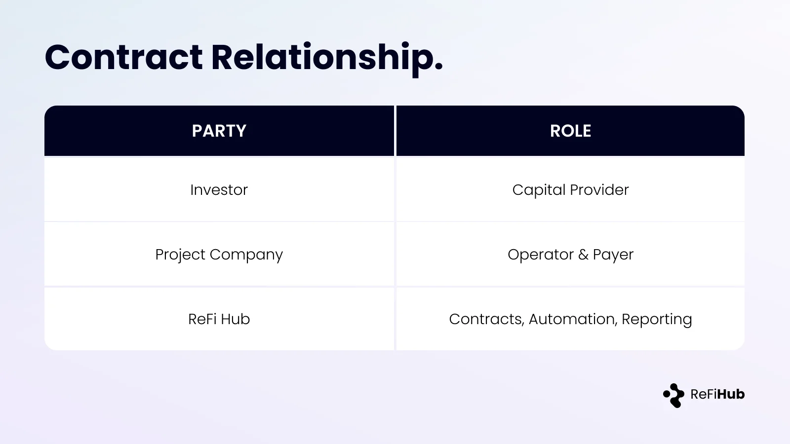
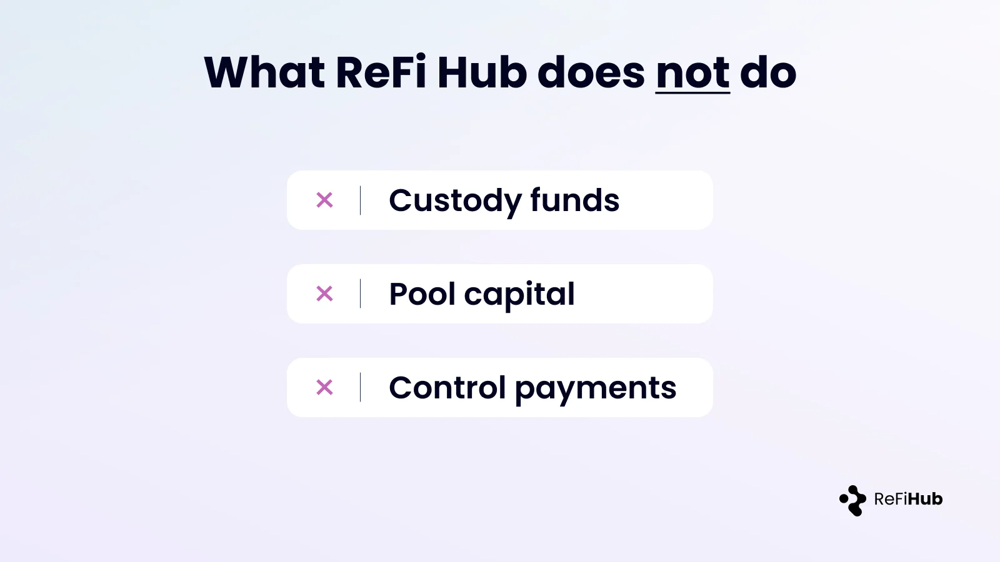
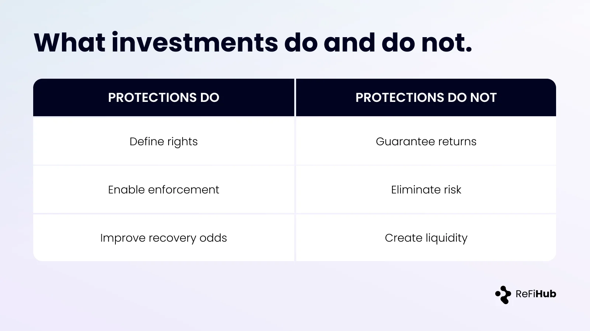

### How Investors Are Protected

This page explains how investor capital is structurally protected on ReFi Hub and how common risk scenarios are handled in practice. It does not imply guaranteed outcomes.

#### The Structural Baseline

Each investment on ReFi Hub is a direct contractual agreement between the investor and the project company.

ReFi Hub does not custody funds, pool capital, or intermediate payments. It provides standardized contracts, automation, and reporting infrastructure.

#### What Supports Investor Claims

Investor rights are defined and enforced through a combination of:

-   Contractual payment obligations
-   Operating cashflows from the asset
-   Asset-level collateral, where applicable
-   Guarantees or covenants, where disclosed

The exact mix is project-specific and disclosed at listing.

### Investor Scenarios

#### 1\. The asset underperforms

If the asset generates less revenue than expected:

-   Investor cashflows adjust in line with actual performance
-   Reporting continues without smoothing or intervention
-   The operator remains responsible for asset operation and maintenance

Underperformance is reflected transparently.

#### 2\. Payments are delayed or missed

If payments are not made as scheduled:

-   Contractual grace periods apply
-   A formal default process can be initiated
-   Cure periods and remedies follow the investment agreement, which typically provides a 15‑business‑day grace period after a missed payment, followed by a formal notice and up to 60 additional business days to cure before an event of default is triggered.

If unresolved, enforcement may proceed under applicable law.

#### 3\. The project company fails

If the project company becomes insolvent or cannot meet its obligations:

-   Asset-level collateral may be enforced, where present
-   Guarantees, if included, may be called under their terms
-   Any recovered value is distributed to investors pro rata

Outcomes depend on jurisdiction, asset value, and legal enforceability.

#### What Protection Does — and Does Not — Mean

Protections are designed to:

-   Define rights clearly
-   Improve recovery prospects in adverse scenarios
-   Align incentives between investors and operators

They do not:

-   Eliminate asset or counterparty risk
-   Guarantee capital or returns
-   Provide secondary liquidity or early exit options

#### Closing Note

ReFi Hub structures investments so that risks are explicit, contractual, and observable.

Investors should assess each project on its own merits using the disclosed documentation.
