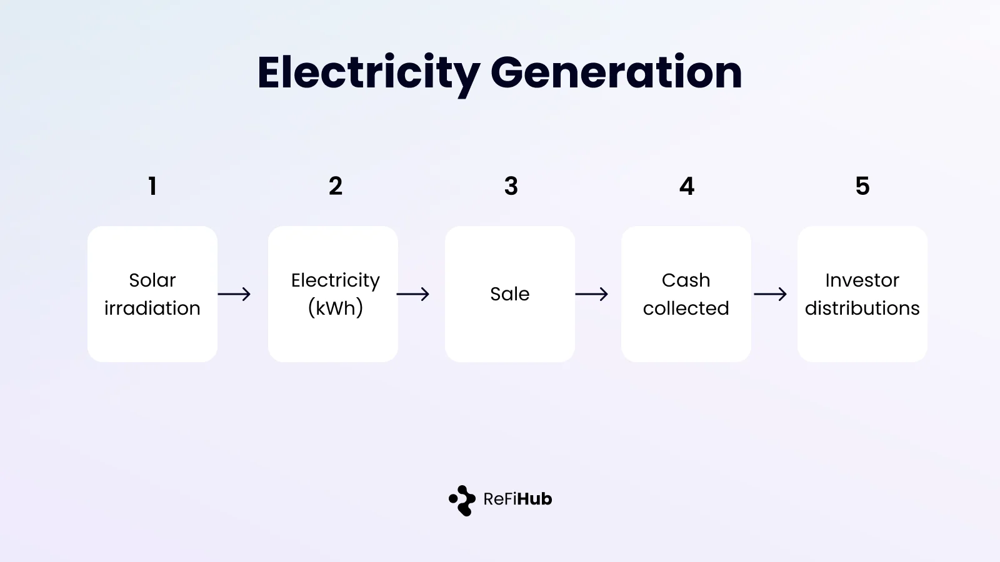
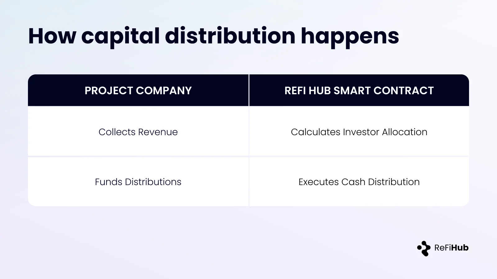

### How Solar Assets Generate Revenue For Investors

This page explains how operating solar assets generate cashflow and how that cashflow supports investor repayments.

#### Electricity Generation

Solar assets generate revenue by producing electricity from installed photovoltaic equipment.

Key drivers include:

-   Installed capacity
-   Asset uptime and availability
-   Local solar conditions
-   Grid connectivity

Once operational, generation is measurable and verifiable through metering.

#### Selling Power

Electricity generated by the asset is sold through one or more of the following mechanisms:

-   Sales to utilities or grid operators
-   Long-term or short-term offtake agreements
-   On-site power purchase arrangements with commercial users

Pricing is determined by contracted terms or prevailing market rates, depending on the project.

#### Additional Revenue Streams

Some projects also generate revenue from:

-   Environmental attributes (e.g. renewable energy certificates)
-   Local incentives or subsidies, where applicable

These revenues are supplementary and disclosed per project.

#### From Revenue to Investor Cashflows

Collected operating revenue is applied according to the contractual structure of the project.

**Primary model (core ReFi Hub structure):**

-   Investor payments are calculated on gross operating revenue generated by the asset
-   No deductions are made for operating or maintenance costs
-   All operating, maintenance, repair, and restoration costs are borne entirely by the project company

This structure is designed to reduce cost leakage and provide clear visibility into top-line asset performance.

**Alternative model (project-specific):**

-   In some cases, operating costs may be **predefined and capped at a fixed level**
-   Investor payments are calculated after those agreed costs
-   Cost assumptions and limits are contractually specified upfront

The applicable model is disclosed at the project level and governed by the investment agreement.

#### How Revenue Is Distributed

In practice:

-   The project company collects operating revenue off-chain
-   On each distribution date, the project company transfers the required amount to the smart contract
-   The smart contract automatically allocates funds to investors according to the agreed terms

ReFi Hub does not custody funds and does not control payment timing or amounts. Responsibility for funding distributions rests entirely with the project company, while the smart contract enforces allocation logic transparently and programmatically.

#### Why Operating History Matters

Assets with operating history provide:

-   Observable generation performance
-   Proven revenue collection
-   Reduced execution risk

For this reason, ReFi Hub prioritizes operating or near-operational solar assets.

#### Closing Perspective

Investor outcomes ultimately depend on how reliably the asset generates and collects revenue over time.

Operational performance is the foundation of all cashflows.
