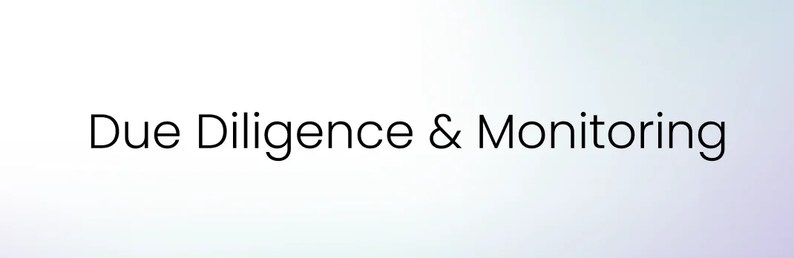

### ReFi Hub Investor Guide

#### What is ReFi Hub?

ReFi Hub is a software platform that enables capital to be deployed into operating energy and electrification assets using standardized legal agreements and automated cashflow distribution.

The platform does not pool capital, manage assets, or intermediate funds. Each investment is asset-specific and contractually direct.

#### What am I actually buying when I invest?

You are acquiring a contractual right to a defined share of net operating revenue generated by a specific infrastructure asset for a fixed term.

You are not purchasing equity, governance rights, or a tradable financial instrument.

#### Are these tokens or investments?

They are investments documented by contracts and recorded on-chain solely to automate settlement and reporting. Tokens are non-transferable, non-tradable, and expire at the end of the investment term.

#### What type of investor is this designed for?

ReFi Hub is built for investors who:

-   Are comfortable with illiquidity
-   Understand variable cashflows
-   Evaluate investments at the asset level
-   Prioritize transparency over optionality

Investors should review all project documentation and seek independent legal, financial, and tax advice before participating.

#### Where do investor payments come from?

Payments are made from actual cash revenue collected by the project company, typically from:

-   Electricity sales
-   Contracted off-take agreements
-   Environmental attributes (e.g. RECs), where applicable

In pure revenue‑share structures, distributions are made only when operating revenue is generated. Some listings may instead use a structured buyback or amortization model, where principal is contractually repaid over time from operating cashflows; these mechanics are disclosed at the project level.

#### How often are distributions made?

Distribution cadence is defined per project and disclosed prior to investment. Most operating assets distribute monthly once live.

#### Are returns fixed?

No. Cashflows are variable and performance-linked. Distributions depend on utilization, uptime, pricing, and operating conditions.

Any estimates shown are illustrative and non-binding.

#### What can cause underperformance?

Key risk drivers include:

-   Lower-than-expected asset utilization
-   Operational downtime or grid curtailment
-   Counterparty payment delays
-   Regulatory or permitting changes
-   Force majeure events

These are asset-level infrastructure risks, not protocol or incentive risks.

#### Is principal protected or guaranteed?

No. Investments are not capital-protected. Investors bear real asset risk and potential loss.

#### Is leverage involved?

Leverage, if any, is disclosed at the project level. ReFi Hub does not add leverage at the platform layer.

#### Are investments secured?

Some investments include credit enhancement such as:

-   First-ranking security over physical equipment
-   Guarantees from operating entities
-   Negative pledges on asset disposal

Security terms are disclosed per listing and governed by the investment agreement.

#### What constitutes a default?

Defaults are contractually defined and typically include:

-   Extended non-payment of revenue
-   Breach of reporting or operating covenants
-   Insolvency or dissolution of the project company

#### What happens after a default?

Where applicable:

-   Enforcement rights may be exercised against collateral or guarantors
-   Recovery actions follow the agreed legal process
-   Recovered funds are distributed pro rata to investors

Recovery outcomes depend on asset value and jurisdiction.

#### Can I pursue my own legal remedies?

Yes. Investors retain independent enforcement rights under the governing agreements.

#### What diligence is performed before listing?

Prior to listing, projects undergo:

-   Business and counterparty review
-   Assessment of operating history or construction status
-   Legal structure and use-of-proceeds review
-   KYC/KYB and sanctions screening

Listing does not imply risk-free performance.

#### What reporting do investors receive?

Depending on the asset, reporting may include:

-   Verified energy production
-   Revenue collected
-   Distribution history
-   Asset uptime and utilization

Data is provided via dashboards, reports, or data feeds.

#### Who is my counterparty?

Your counterparty is the **project company**, not ReFi Hub.

ReFi Hub provides software, documentation, and reporting infrastructure but does not custody funds and does not assume payment obligations.

#### Are these securities?

Each investment is structured as a contractual revenue participation. Regulatory treatment varies by jurisdiction. Investors are responsible for compliance with local laws.

#### Who can invest?

Eligibility is jurisdiction-dependent and subject to KYC/AML screening. Certain jurisdictions, including the United States, Ontario, Singapore, are excluded.

#### How long does the investment last?

Each investment has a clearly defined term disclosed upfront.

Typically long term revenue share deals last 20-30 years - the operational life of the solar asset. Shorter term deals, with buy back mechanisms, last 3-5 years.

#### What happens when the term ends?

At the end of term:

-   Revenue participation ceases
-   Tokens automatically expire
-   No further claims exist other than unpaid amounts accrued prior to expiry

#### [Visit Gitbook for more Information](https://refihub.gitbook.io/refi-hub)

For full documentation: including fees, geographic focus, technology architecture, legal terms, and policies — visit our [Investor Resources on GitBook.](https://refihub.gitbook.io/refi-hub)
