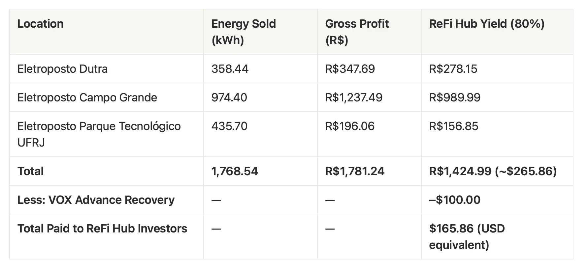

#### Summary: Early-Stage Operations in Progress

This reporting period marks the second month of operations across VOX’s EV charging network in Rio de Janeiro.

The period reflected a setup and stabilization phase, with additional chargers still coming online and initial awareness activities underway. Revenue during this phase reflects commissioning-stage uptime and early utilization.

As a reminder, the Month 1 payment was unusually high due to a contractual top-up from VOX, not from operational revenue. That payment was designed to meet the minimum return commitment while infrastructure was still being installed, and is now being gradually recovered, as outlined below.

#### Revenue Breakdown Month 2

Note: Campo Grande and Dutra were only operational for since mid month, during this period.

###### Why Was a $100 Discount Applied?

In Month 1, only one site was live. To meet the **contractual 3% minimum payment**, VOX covered the shortfall with their own funds.

This $100 is part of a gradual recovery of that early advance. It’s the first of 11 equal repayments — not a penalty, and not related to this month’s earnings. Just part of how the agreement balances early-stage support with long-term sustainability.

#### Investment Timeline and Long-Term Obligations

We understand early-stage returns can feel modest, however it is important to highlight two things clearly:

**First**, the majority of chargers have only just come online. In Month 2, two of the three sites were operational for less than half the month. Naturally, this limited the total revenue generated.

**Second**, even once all chargers are fully live, usage builds gradually. Like any real-world infrastructure, these assets experience a **ramp-up phase** — particularly in new EV markets.

Together, these two factors explain why early returns are low, but neither is permanent. As we move into full uptime and visibility improves, we expect noticeable revenue growth to begin in the months ahead.

#### Contractual Payment Structure

Each VOX token represents a contractual participation in a five-year operating lease, with scheduled monthly payments commencing **October 5, 2025** and running through **September 5, 2030**.

Under the lease terms, payment obligations are defined by cumulative distribution mechanics rather than a fixed maturity outcome. Where specified thresholds are not met by the scheduled end date, payment obligations may extend in accordance with the contract until those conditions are satisfied.

This structure links participant outcomes to **asset-level operating performance and contractual payment terms**, rather than to arbitrary calendar timelines.

View full contract here: [VOX EV Equipment Lease Participation Agreement](https://refihub-public-resources.s3.eu-central-1.amazonaws.com/EV+Equipment+Lease+Participation+Agreement+.pdf)

#### Understanding the Yield Arc: What Comes Next

The current yield is well **below the annual target of 40% annually**, but this is expected in the early phase of infrastructure deployment.

Several growth drivers are now coming into effect:

-   **3 sites now fully live**, 2 of them operating a complete month for the first time
-   **Increased awareness and traffic**, with marketing, app visibility underway
-   **An additional charging site** is being prepared, adding more capacity
-   **Utilization growth** as EV adoption accelerates in the region

With all sites online and awareness growing, we expect revenue to rise steadily from here. We’ll continue to share timely, transparent updates as progress unfolds.
