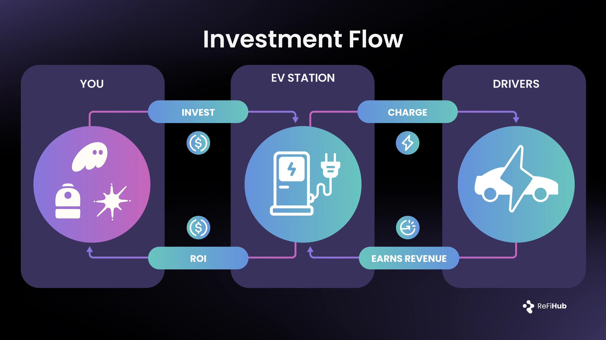

## Access to EV Charging Infrastructure, Without Laying a Single Cable?

EV charging networks are real infrastructure. They require site agreements, grid upgrades, hardware deployment, maintenance, and uptime discipline. That complexity is why ownership has largely remained with operators, utilities, and large developers.

For most investors, the barrier is not interest. It is access. The market is fragmented, projects are operationally intensive, and performance is difficult to underwrite without direct visibility.

This is where **ReFi Hub** operates.

ReFi Hub provides structured access to operating EV charging infrastructure through contractual revenue participation. Assets are installed and operated off-chain, while cashflow routing and performance reporting are handled programmatically.

Participation is recorded through **Fractional Infrastructure Tokens (FITs)**, which represent a defined entitlement to asset-level cashflows under the project’s legal agreements. These instruments are tied to physical charging infrastructure and realized operating performance, not speculative token value.

###### How Access WorksCapital is deployed into individual EV charging projects with defined locations and operating terms. Once commissioned, chargers generate revenue from drivers paying per charging session.

Cashflows are distributed in line with the contractual structure and reported based on observed utilization and operating performance. Distributions vary with usage and conditions and are not fixed outside the contract terms.

###### Why It Matters

EV adoption continues to increase baseline electricity demand, and charging infrastructure is a required layer of that system. Chargers already in the ground serve immediate demand and form the backbone for future growth.

ReFi Hub exists to connect capital to this infrastructure layer, providing access to assets that are already operating in the real economy.

Further details on active and upcoming EV charging projects are available at:  
[**https://app.refihub.io**](https://app.refihub.io/)
