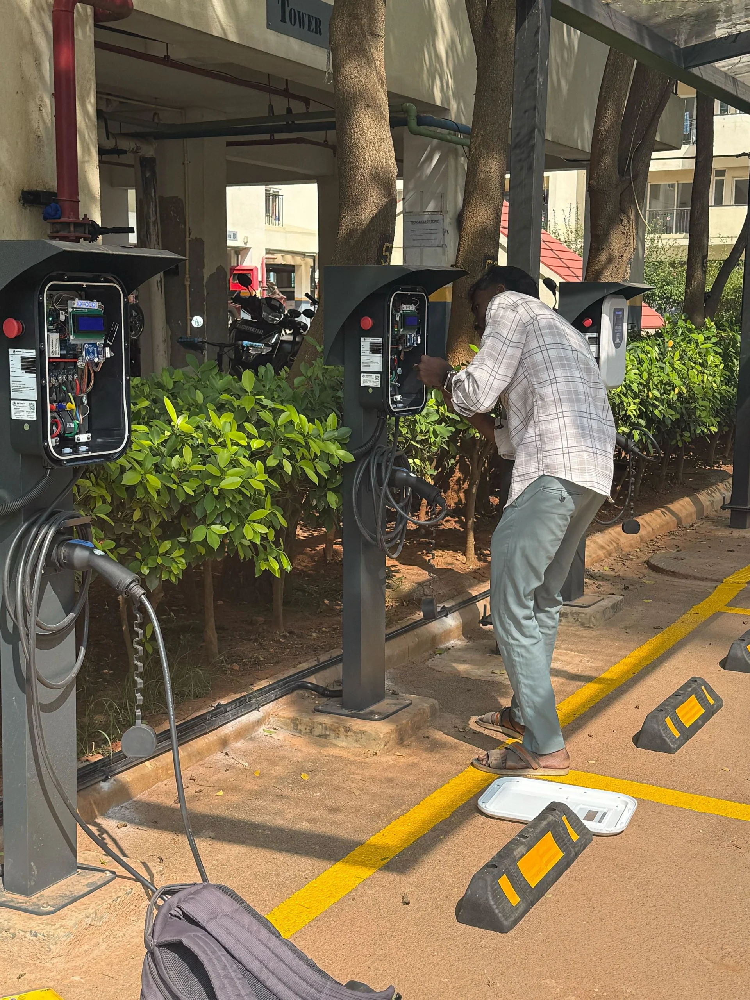
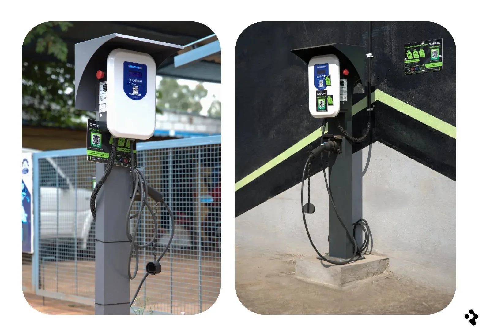

### EV Charging Infrastructure | Bangalore, India

[DeCharge](https://www.decharge.network/) has completed the full deployment of [ReFi Hub's Project Surya](https://www.refihub.io/investments/7/), with all 21 chargers live and operational across Bangalore and nearby highway corridors.

The network has now entered its early operating phase, where utilization builds through driver discovery, fleet partnerships, and repeat usage. This update covers deployment status, operational performance, and the first month of revenue distribution.

This report focuses on what is live, what is working, and what we are watching:

#### Deployment Status

Total chargers deployed: 21

\- 15 × 7.4 kW AC chargers

\- 2 × 60 kW DC chargers

\- 4 × 30 kW DC chargers

**Deployment completed:** First week of December

**Uptime:** Consistently above 95% across the network

The final charger mix was adjusted from the original plan replacing x1 60kW DC for x2 30kW DC. This adjustment was based on site-level power availability, traffic patterns, and utilization expectations, resulting in a configuration better aligned with real operating conditions.

All sites include:

\- Clearly marked bays and safety protocols

\- Secure mounting and protective infrastructure

\- On-site branding and instructions to improve user awareness

#### Location & Demand Context

The network is distributed across high-traffic industrial areas and highway corridors in and around Bangalore, with several sites benefiting from multi-highway connectivity.

Current estimated EV catchment: 45–90 vehicles per site, per day

Projected over next 12 months: 120–180 vehicles per site, per day driven by:

\- Fleet usage

\- Commuter traffic

\- Intercity travel patterns

All locations have confirmed grid load and approved permits, removing a key infrastructure risk at this stage.

### Operational Performance (First Payout Period)

#### Energy & Usage

Total energy delivered (month):

\- AC chargers: 3,996 kWh

\- DC chargers: 21,059 kWh

\- Average daily sessions per charger:

-   AC: ~1.5 sessions
-   DC: ~5 sessions

This distribution reflects expected early behavior: DC chargers capturing higher-frequency usage, while AC chargers build steadier, longer-duration demand over time.

#### Revenue & Distribution

**\- Capital deployed from investors:** $150,000

**\- Total monthly revenue:** $3,889

**\- Distributed to investors:** $2999

Based on the first operating month, current distributions imply a high-teens to high-20s annualised range, though this reflects early utilization and should not be treated as a stabilized return.

Operating margins at this stage reflect:

-   AC chargers: ~46%
-   DC chargers: ~51%

These figures are a function of utilization, electricity costs, and early operating efficiencies, and will continue to normalize as usage patterns stabilize.

#### What Matters Now

At this stage of the asset lifecycle, the primary focus is: 

\- Uptime and reliability

\- Utilization trends by site and charger type

\- Fleet partnerships supporting baseline demand

\- Evidence of repeat usage

Early variance across chargers and locations is normal in EV infrastructure. What compounds over time is site maturity, visibility, and consistent operations.

#### Looking Ahead

\- Recent operating months have shown revenue variance of approximately ±10%, reflecting early-stage utilization dynamics.

\- Future updates will include more detailed breakdowns as the operating history lengthens.

#### Closing Note

This deployment represents real, operating energy infrastructure, not a simulation or incentive-driven system. Early payouts reflect actual charging activity on the ground.

Early utilization and distributions are consistent with initial operating expectations for newly deployed EV infrastructure, with DC chargers showing stronger early throughput as anticipated.

As with all infrastructure, performance is a function of time, utilization, and operations, not short-term signals. Reporting will continue to prioritize transparency and observable data over forward-looking claims.

