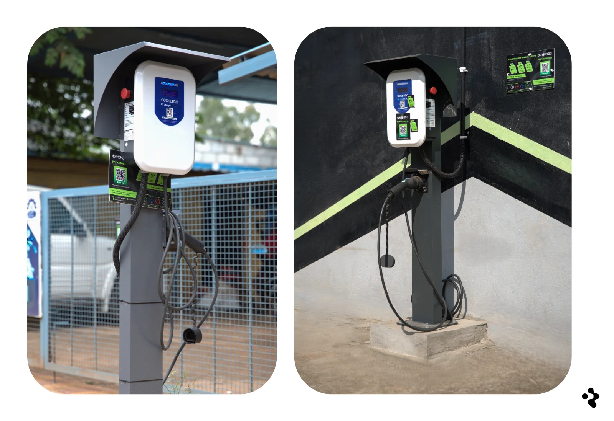
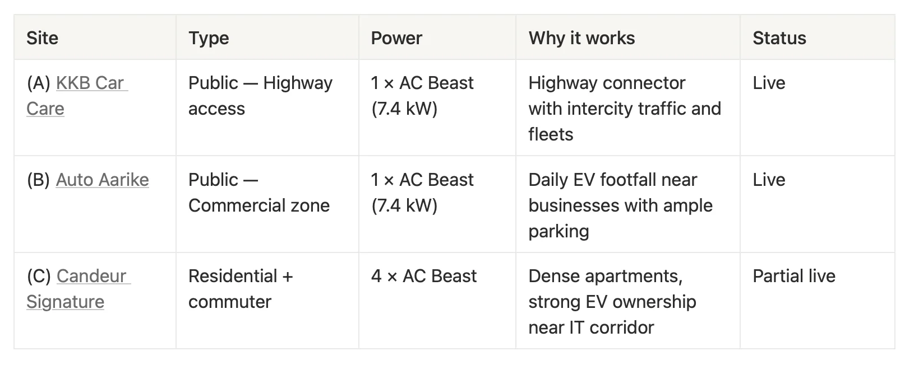
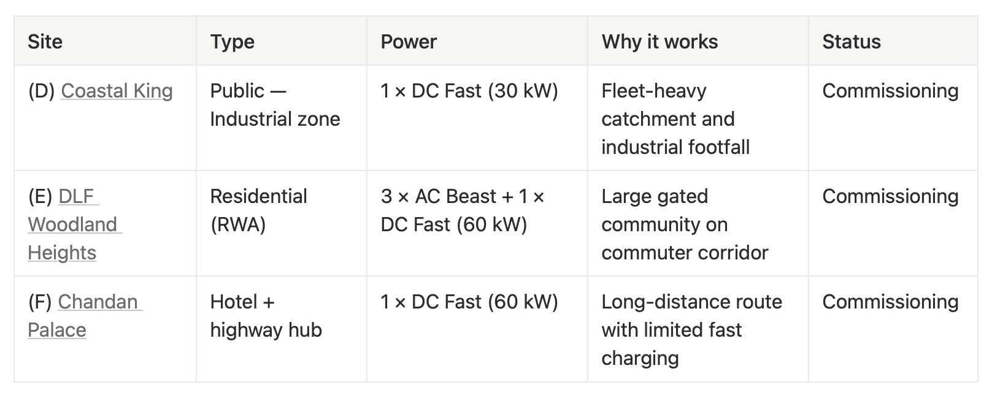
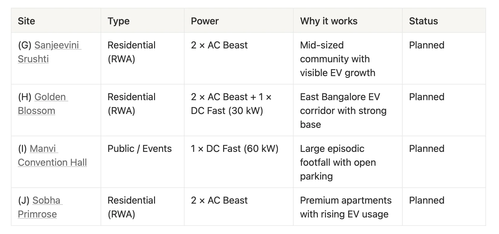
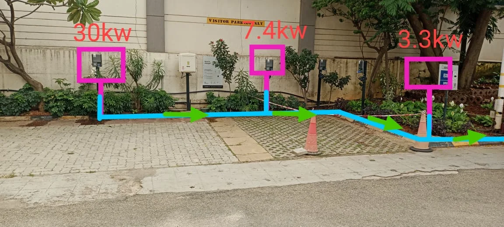
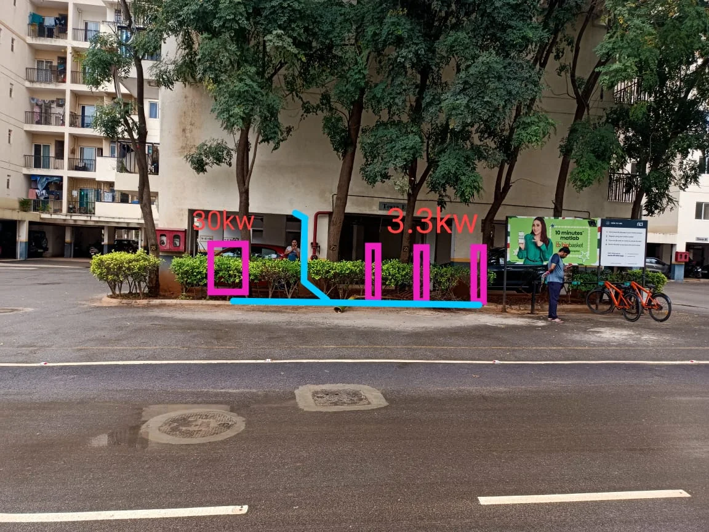
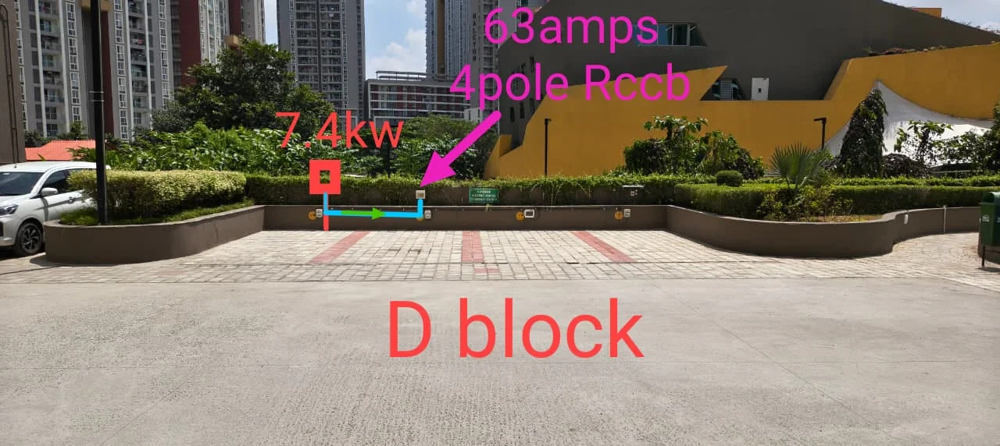

### DeCharge Investor Update - Bangalore rollout, momentum building

##### Why this matters now

Capital has been deployed across multiple operating sites. Two public locations are live, one residential site is partially operational, and three additional locations are in commissioning.

As sites come fully online and appear across relevant charging networks and mapping platforms, utilization data will be monitored and reported as observed.

##### Rollout snapshot

-   Sites live: 2
-   Partial live: 1
-   Commissioning: 3
-   Planned: 4
-   Hardware mix: Fast DC 60–30 kW and AC “Beast” 7.4 kW
-   First investor payout on time: **expected 20 January 2026**

##### The network now

###### Live and partial live

###### Commissioning (civil or final approvals)

###### Planned (consideration or pipeline)

##### How your returns grow

With EV charing infrastructure, it is important to consider the growth and adopting curve.

Usage grows with time, as drivers find the site and make it part of their routine. App listings and local word of mouth steadily lift utilization after go‑live. Additionally, EV adoption is continually increasing overtime, meaning more total demand for charging.

DeCharge are leveraging their local knowledge, placing charges in diversified locations; public, residential, commuter corridor roads. With the goal of reaching 30–60 sessions/month initially and 100–180 sessions/month long term.

##### What’s next : Milestones

**M1**: Kicking off DLF Woodland Heights and Chandan Palace and Coastal King

**M2**: Add three more residential sites, with growing EV adoption

**M 2.1**: Expand with fast-chargers along long-distance routes with limited fast charging and high footfall convection centre.

##### Transparency and control

We’re working with DeCahrge to set up:

-   Weekly snapshot: sessions, kWh dispensed, uptime
-   Monthly: revenue, downtime causes, fixes
-   Exploring investor data: with a beta, with per-site live metrics and history

##### Payout timeline

-   DeCharge is expecting the first payout to be on the **20th of January 2026**
-   Frequency: monthly
-   Dependencies to watch: final commissioning dates, grid energization, and app listings

##### The bigger picture

We’re building reliable, local charging that turns daily miles electric.

-   Targeting commuters, fleets, residential blocks with shared chargers.
-   Simple hardware, high uptime.

**Compounding impact**

-   One visible site attracts the next
-   High uptime turns first tries into habits. Habits become revenue.

**Why we’re excited:**

-   EV growth is outpacing neighborhood charging.
-   Your funding puts reliable chargers where they’re needed, turning range anxiety into easy availability.
-   Upside: a cash‑generating network that scales with adoption.

##### Site Photos

**Tech Spec Notes:**

In one case, 1 x 60 kW charger was replaced with 2 x 30 kW for operational efficiency and wider demand capture. The rest of charger deployments match original plans.

#### Sources & References

**Map Links**

-   **Coastal King**: [View](https://www.google.com/maps?q=Coastal+King,+16/1,+SM+Rd,+Kalahasti+Nagar,+Prashanth+Nagar,+T.+Dasarahalli,+Bengaluru,+Karnataka+560015,+India)
-   **KKB Car Care**: [View](https://maps.app.goo.gl/AyLwaCVaC4NGCtFc6)
-   **Auto Aarike**: [View](https://www.google.com/maps?q=No+30/3,+Magadi+Main+Road,+Kadabagere+Cross,+Bangalore+-+562130)
-   **Candeur Signature**: [View](https://www.google.com/maps?q=Varthur+Main+Rd,+behind+Croma+Store,+Gunjur+Village,+Varthur,+Bengaluru,+Karnataka+560087)
-   **DLF Woodland Heights**: [View](https://maps.app.goo.gl/JhFEU28wmXaMGVng7)
-   **Chandan Palace**: [View](https://maps.app.goo.gl/nwr7hQUhEdpQUwW26)
-   **Sanjeevini Srushti:** [View](https://maps.app.goo.gl/ghFf8fadWb8MU8jC7)
-   **Golden Blossom**: [View](https://maps.app.goo.gl/YQDxgcpeR4T7zZR68)
-   **Manvi Convention Hall**: [View](https://maps.app.goo.gl/vXbZRVTT6PX44Cbv5)
-   **Sobha Primrose**: [View](https://www.google.com/maps?q=Sobha+Primrose,+Bengaluru,+India)
