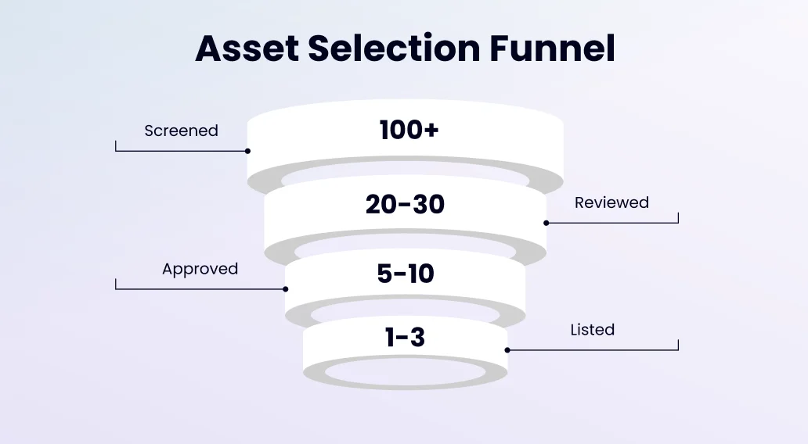
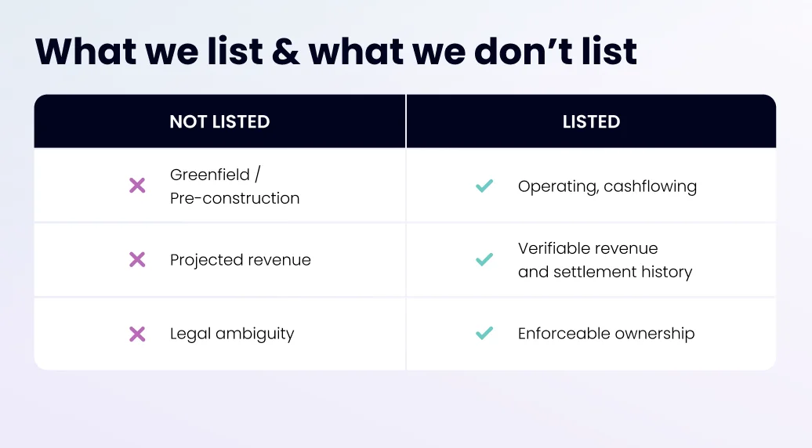
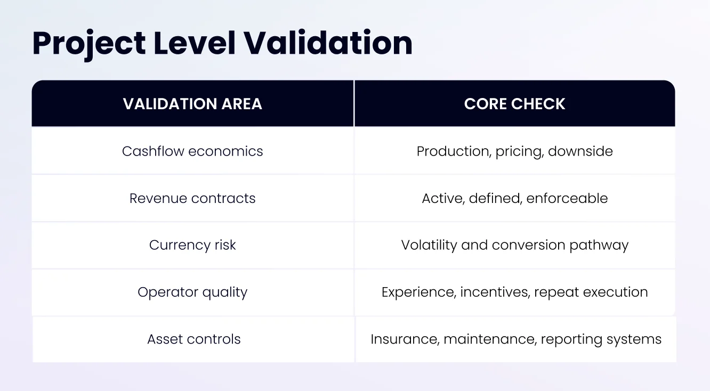
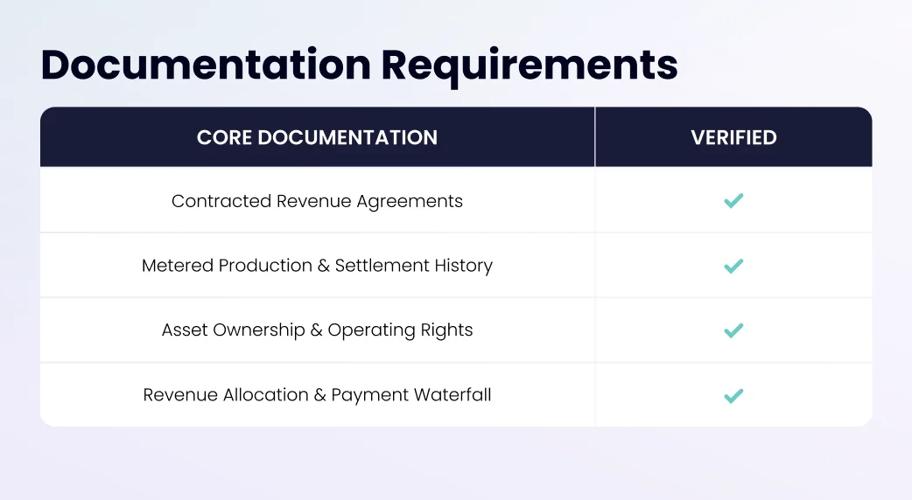

## Business Due Diligence Framework

ReFi Hub lists operating energy infrastructure.Before any listing, we validate three fundamentals:

1.  The asset can generate durable cashflows typically ranging 10-15% IRR.
2.  Legal and contractual rights are enforceable.
3.  Risk is transparent and structurally understood.

Tokenization enables the administrative infrastructure, cashflow quality is the foundation.

### Geographic Assessment (Macro Filter)

All projects are screened at the jurisdiction level before asset review.

We assess:

-   Energy market economics
-   Contract enforceability
-   Creditor protections
-   Currency stability and convertibility
-   Historical precedent for similar projects
-   Depth and reliability of local operators

#### Core Geographical Focus Regions

##### Brazil

-   High solar irradiance and favorable generation economics
-   Established operator partnerships
-   Competitive installation costs
-   Contracted or semi-contracted revenue visibility

##### Singapore

-   Strong rule of law and contract enforcement
-   Currency strength and lower FX volatility
-   Premium REC pricing dynamics
-   Institutional-grade counterparties
-   Established developer ecosystem
-   Strong, repeatable developer relationships

##### Southeast Asia (via Singapore-Based Developers)

Regional expansion is pursued selectively and only through:

-   Singapore-incorporated or Singapore-regulated developers
-   Operators with established governance standards
-   Structures where contractual enforceability can be anchored in Singapore

Singapore functions as a beachhead jurisdiction, enabling access to broader regional energy demand growth while maintaining institutional counterparty standards.

### ReFi Hub Validation Process (Project-Level)

Once a project passes the geographic filter, we conduct structured validation across five areas.

#### Economic Viability

-   Historical or modeled kWh generation and settlement history
-   Percentage of plant contracted and electricity pricing cross-checks
-   Financial statement analysis
-   Sensitivity to downtime or underperformance

#### Contract Integrity

-   Revenue contracts are active and current
-   Payment obligations are clearly defined
-   Rights are not dependent on fragile assumptions

#### Foreign Exchange Exposure (If Applicable)

-   Currency volatility profile reviewed
-   Conversion mechanics into USDC tested
-   On/off-ramp reliability assessed

#### Operator Assessment

-   Track record in solar or energy infrastructure and prior project delivery
-   Counterparty quality and incentive alignment
-   Depth of Singapore and regional developer relationships (repeat operators preferred given the trust built and ability to scale)

#### Operational Controls & Insurance

-   Insurance coverage and maintenance procedures
-   Breakdown response framework
-   Reporting capability (energy generation, billing and invoices)

### Documentation & Execution Requirements for Solar Developers

The following documentation is collected and verified:

1.  **Revenue contracts and off-take agreements;** confirms contractual cashflow source and enforceability with counterparties

2.  **Renewable Energy Credits (RECs) issuance documentation;** validates secondary revenue stream where applicable

3.  **Historical generation data and settlement statements;** demonstrates actual energy output, kWh delivered, and revenue realized over time

4.  **Project asset schedule and operating control documentation;** identifies financed equipment, physical location, and operational oversight rights

5.  **Insurance policies and maintenance framework;** verifies asset protection

6.  **Corporate formation documents and authorized signatories;** establishes entity legitimacy and contractual authority

7.  **Financial statements;** includes balance sheet, income statement, cash flow statements, and other financial records demonstrating fiscal health and performance

8.  **Financial structure and waterfall mechanics;** details raise parameters, Net Revenue allocation, and payment schedule

9.  **Operational payment readiness;** confirms USDC wallet setup and successful test transaction

### Reach out to us for any questions

You can visit our:   
[Discord investor support server.](https://discord.gg/yZ9fp43wCd)

Alternatively get in touch via email with Christian, Head of Legal & Due Dilligence team:  
christian@refihub.io
