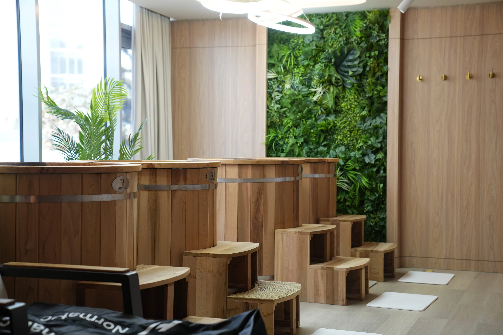
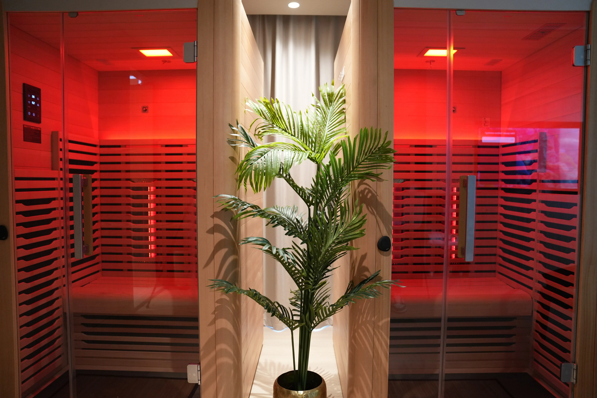
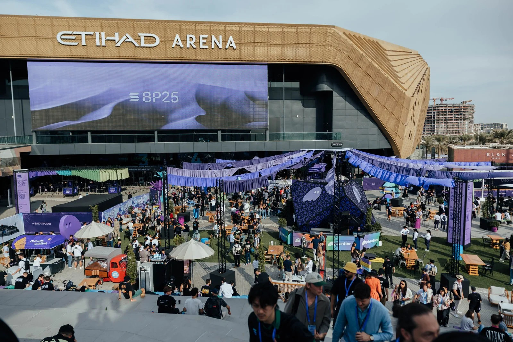
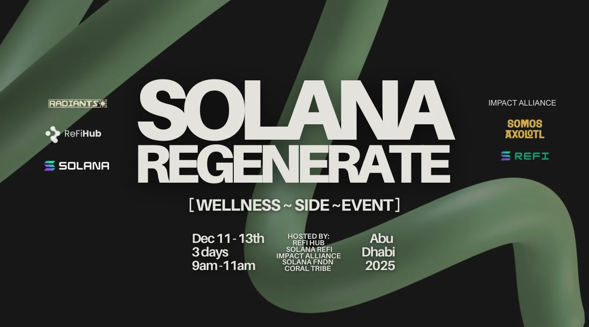

#### A Solana Breakpoint Morning, Reimagined

Solana Breakpoint 2025 was intense. In the best way.

Big ideas, fast conversations, packed rooms, and a community at the edge of what’s possible in Web3.

But before the conference floor came alive, something different happened.

On three quiet mornings ahead of Breakpoint, Regenerate opened its doors: a pre-conference wellbeing experience designed to help people arrive grounded, connected, and ready to perform.

#### A Different Kind of Networking

Regenerate brought together builders, investors, operators, for a set of simple but powerful experiences: ginger shots, guided breathwork, sauna, ice baths, and full-body cryotherapy chambers.

Yes—people were literally networking in ice baths.

Phones down. Nervous systems online. What emerged was presence, curiosity, and connection.

#### Regeneration as a Core Value

The idea behind Regenerate Event was simple: Recharge. Connect. Perform.

In regenerative finance, the goal is not growth at all cost. It’s about designing systems that sustain themselves over time.

#### The Solana Community, At Its Best

What made Solana Breakpoint special was the people.

The Solana community consistently shows up with openness, collaboration, and a willingness to embrace the unknown. At Breakpoint, that spirit was everywhere.

#### A Collective Effort

Regenerate was sponsored by the [Solana Foundation](https://solana.org/) and coordinated by [ReFi Hub](https://www.refihub.io/) in collaboration with Solana ReFi, Solana’s public goods and regenerative finance community.

It was built as a gift to the ecosystem: a moment to pause, reset, and remember why people are building in the first place.

We were joined by some amazing companies such as;

[Centrifuge](https://centrifuge.io/) , [Radiants](https://x.com/RadiantsDAO), [Somos Axoltl](https://somosaxolotl.com/), [Backpack,](https://backpack.exchange/) [Pump.Science,](https://pump.science/) [EndCorp](https://endcorp.co/), [Flight3](https://www.flight3.xyz/) and many many more.

### Moving Forward

Breakpoint 2025 was epic. The energy. The scale. The ambition. Non-stop bullish announcements. The foundations are set, and they’re here to last.

All the announcements and talks are available [here](https://solana.com/breakpoint)

It is in moments like the Regenerate side event that are a reminder that progress doesn’t only come from pushing harder. Sometimes it comes from slowing down together. Recalibrating. Choosing to build systems—financial and human—that are designed to endure.

Recharge. Connect. Perform.

And keep building.

[Join Solana ReFi](https://solanarefi.com/) - the public, social and environmental goods community on Solana.
