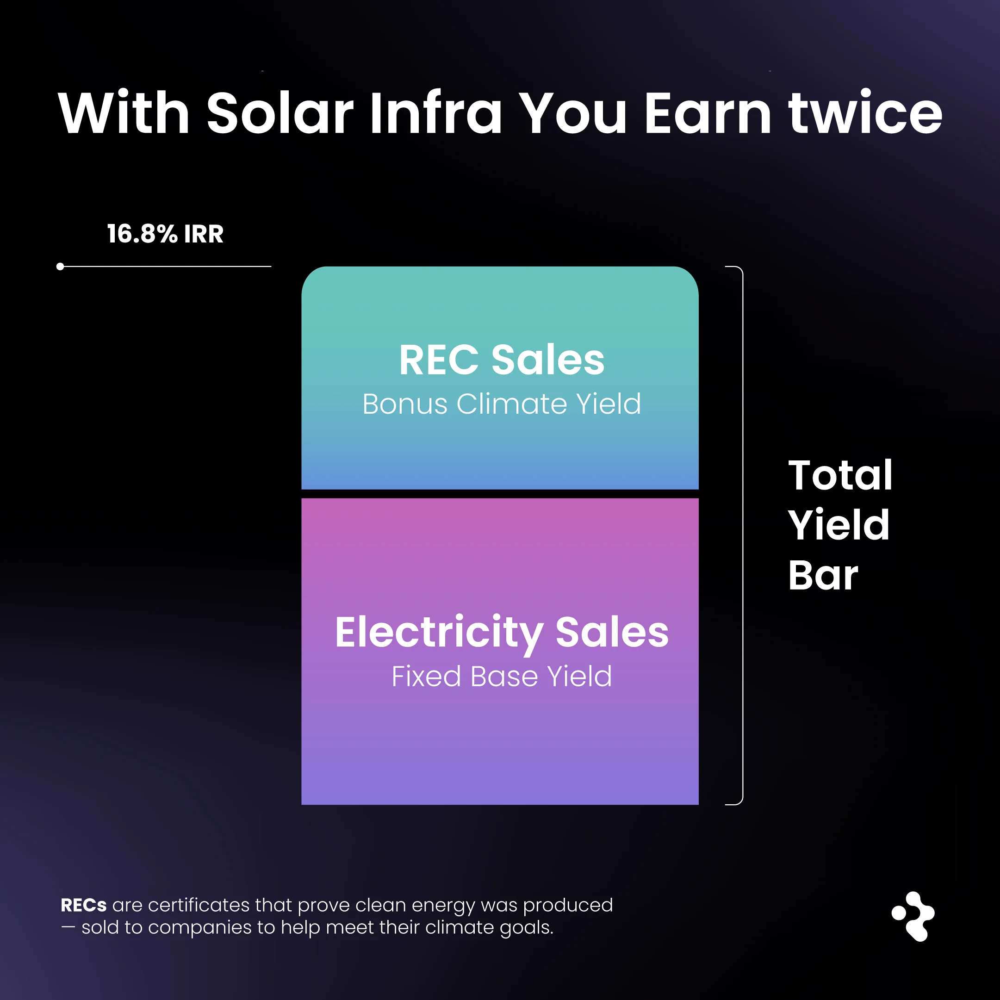

### Singapore's Solar Projects Dual-income with RECs, How to Benefit with ReFi Hub

Solar projects typically monetize electricity generation. In certain markets, including Singapore, additional revenue may be generated through environmental attributes associated with that production, creating layered revenue streams at the asset level.

Let’s break it down:

**Primary and Secondary Revenue Components**

Certain solar projects in Singapore generate revenue from two distinct sources:

-   **Electricity sales** from grid-connected generation
-   **Renewable Energy Certificates (RECs)**, which represent the environmental attributes associated with verified clean electricity production

These revenue components are accounted for separately and are tied to the same underlying energy output.

##### What Are RECs, and Why Do They Matter?

Renewable Energy Certificates (RECs) represent the verified environmental attributes of electricity generated from renewable sources and are settled separately from the sale of power.

In Singapore, demand for RECs is shaped by a simple structural reality: limited local supply and sustained corporate procurement. Physical constraints on land and rooftop space restrict new solar capacity, while large electricity consumers — including global technology and manufacturing firms with local operations — are required to source verified environmental attributes within the market.

As a result, Singapore’s REC market has consistently cleared at some of the highest prices globally over multiple years, reflecting this persistent supply–demand imbalance. REC pricing remains market-driven and variable, and is reported as observed over time.

##### The Data Backs It Up

Singapore’s Renewable Energy Certificate market has expanded materially in recent years, with estimated market value rising from approximately **USD 32.5 million in 2024**, supported by corporate procurement requirements and constrained local supply.

REC prices in Singapore have **consistently cleared at a premium relative to other Asian markets**, often several multiples higher. Reported transactions have commonly ranged around **USD 30–40 per certificate**, compared with materially lower prices in less supply-constrained jurisdictions.

For operating solar assets, REC sales represent an **incremental revenue component** alongside electricity sales.

##### ReFi Hub and the Pivot Green Opportunity

This is the context in which **ReFi Hub** operates. One current listing, **Pivot Green**, manages an operating rooftop solar asset in Singapore that is already producing electricity and associated Renewable Energy Certificates.

The project generates revenue from electricity sales and REC settlements, both tied to verified on-site generation. These revenues are reported at the asset level.

Through ReFi Hub’s platform, participants access a contractual revenue-share participation linked to the operating performance of the asset.

[Explore the listing here](http://app.refihub.io/investments/8/)

##### REC-Specific Risks

Renewable Energy Certificates are subject to several identifiable risk factors:

-   **Market risk:** REC pricing fluctuates based on corporate procurement demand, supply conditions, and broader energy market dynamics.
-   **Regulatory risk:** Changes to sustainability reporting standards or government policy may affect REC eligibility, pricing, or usage.
-   **Asset performance risk:** REC issuance is directly tied to electricity generation; underperformance or technical issues at the asset level reduce both power and REC revenue.
-   **Market maturity:** While growing, the REC market remains relatively small and evolving, with liquidity and pricing structures that may change over time.

##### The Takeaway

Singapore solar assets generate **operating cashflows** from electricity sales and Renewable Energy Certificates, shaped by constrained supply and sustained corporate demand. Through **ReFi Hub**, participation is structured as contractual exposure to **live, cash-generating assets**, with distributions reflecting actual operating cashflows as they are realized.

\-> See Pivot Green listing page: [**http://app.refihub.io/investments/8/**](http://app.refihub.io/investments/8/)
