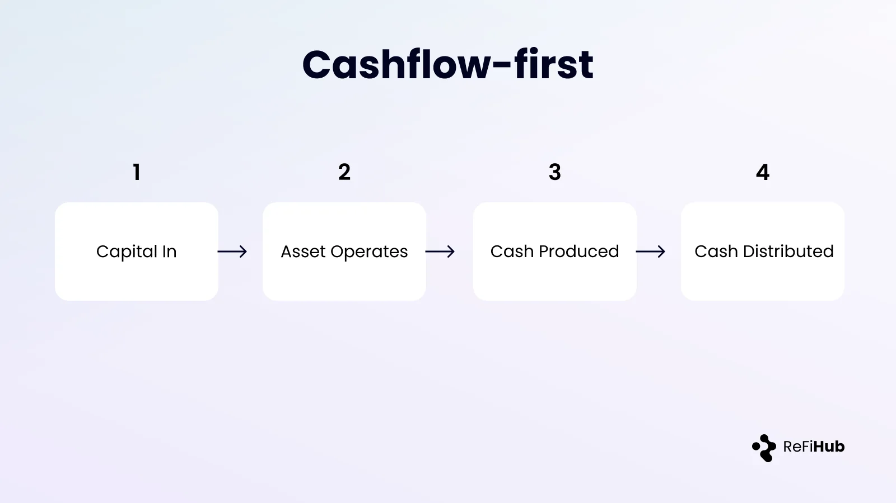
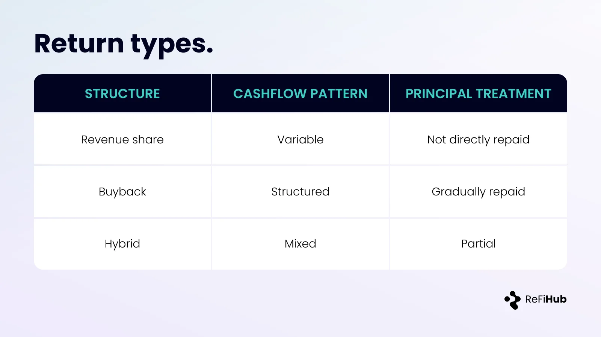
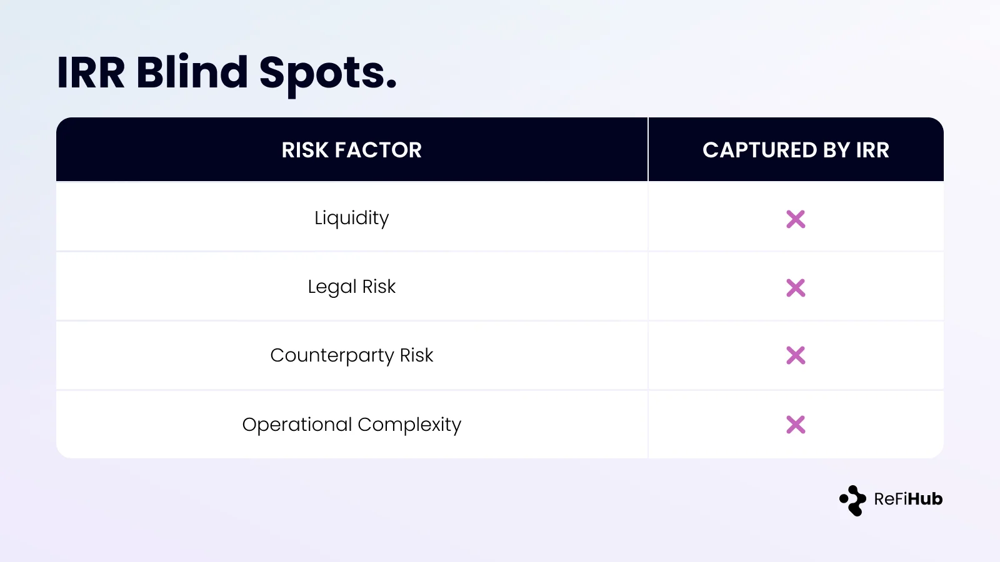
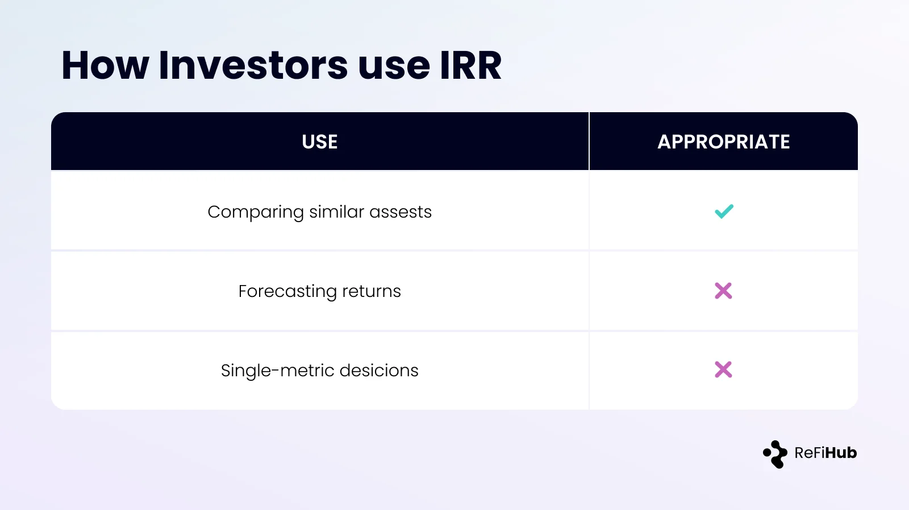
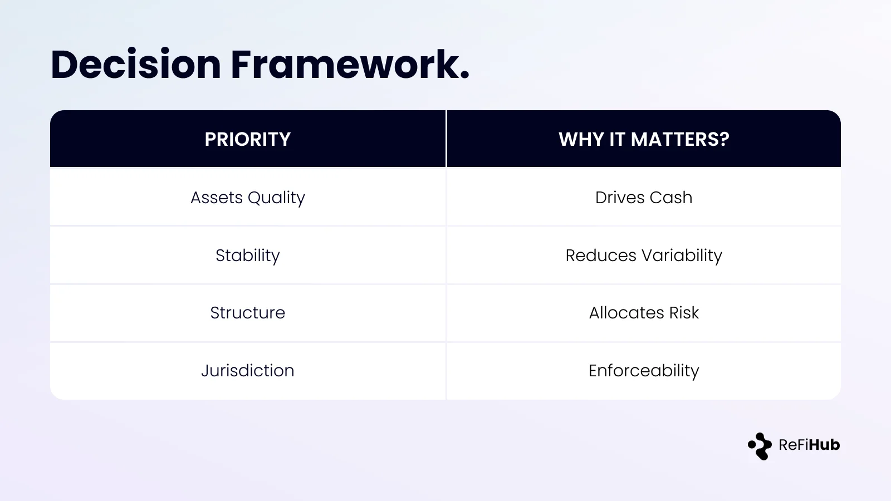

### Understanding Returns and IRR

This page explains how returns are generated, measured, and interpreted on ReFi Hub. It is intended to support evaluation of infrastructure investments.

#### What “Returns” Mean on ReFi Hub

Returns on ReFi Hub are derived from **observed cashflows generated by operating assets**. They are not promised, fixed, or incentive-driven.

Depending on the project structure, returns may take the form of:

-   Periodic revenue-share distributions
-   Contractual buybacks, where invested capital is gradually repaid over time
-   A combination of both

A **buyback** is a structure where invested capital is repaid over time from operating cashflows. Further detail is provided below.

All returns are asset-specific and depend on actual performance.

#### What Is IRR?

Internal Rate of Return (IRR) is a standard project-finance metric used to describe how efficiently an investment turns cashflows into returns over time. It is widely used in solar and other infrastructure assets because cashflows are long-term, predictable, and tied to physical operations rather than market exits.

IRR reflects:

-   The timing of cash inflows and outflows
-   The duration of the investment
-   The pace at which capital is returned

It allows different projects with different cashflow profiles to be compared on a normalized basis.

#### How IRR Is Calculated in Practice

On ReFi Hub, IRR calculations typically assume:

-   An initial capital outlay at the time of investment
-   Periodic cash distributions based on reported asset performance
-   No reinvestment assumptions beyond received cashflows

Where IRR figures are shown, they are based on modeled or historical cashflow scenarios, not guarantees.

### Revenue Share vs Buyback Structures

#### Revenue Share

In revenue-share structures:

-   Distributions fluctuate with asset performance
-   Principal is not repaid directly
-   IRR depends heavily on long-term utilization and pricing

#### Buyback / Amortization

In buyback structures:

-   The project company commits to repurchasing the investor’s participation over time
-   Repayments are made from operating cashflows generated by the asset
-   As repayments occur, economic ownership of the asset incrementally returns to the project owner
-   Cashflows are typically smoother than pure revenue share
-   IRR is influenced by the repayment schedule, asset uptime, and revenue stability

Buybacks are commonly used in solar and infrastructure where asset ownership is intended to remain with the operator over the long term, while external capital is repaid in a structured manner.

Both structures remain dependent on operating cashflows.

#### What IRR Does Not Capture

IRR does not fully reflect:

-   Asset liquidity or exit constraints
-   Jurisdictional or enforcement risk
-   Counterparty credit risk
-   Operational complexity

These factors should be assessed separately using project documentation.

#### How Investors Should Use IRR

IRR is most useful when:

-   Comparing projects with similar risk profiles
-   Evaluating the timing of capital return
-   Assessing whether cashflow pace aligns with portfolio needs

It should not be used in isolation or treated as an expected outcome.

#### Closing Perspective

ReFi Hub prioritizes transparent cashflow reporting over headline return figures. Investors are encouraged to focus on:

-   Asset quality
-   Cashflow durability
-   Structural protections
-   Jurisdictional enforceability

Return outcomes are primarily driven by asset performance, operating stability, and cashflow consistency over the life of the project.

